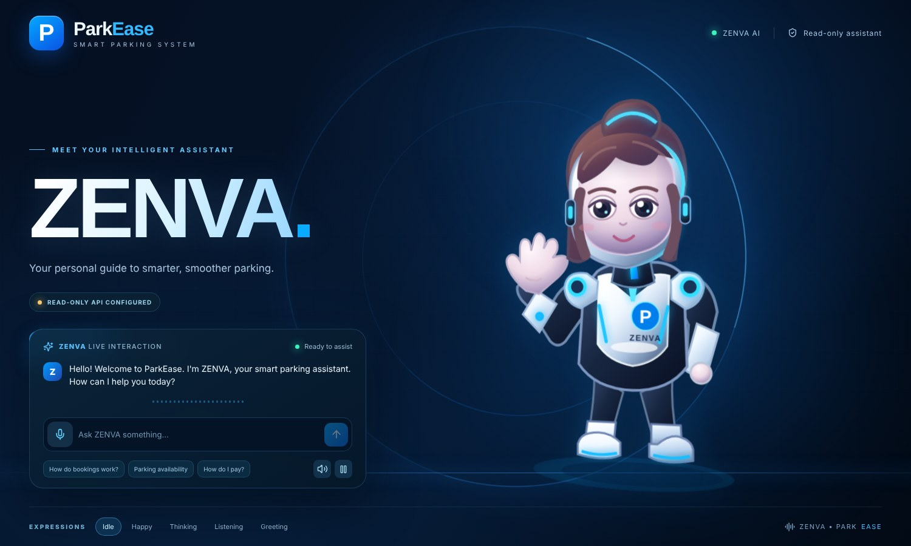
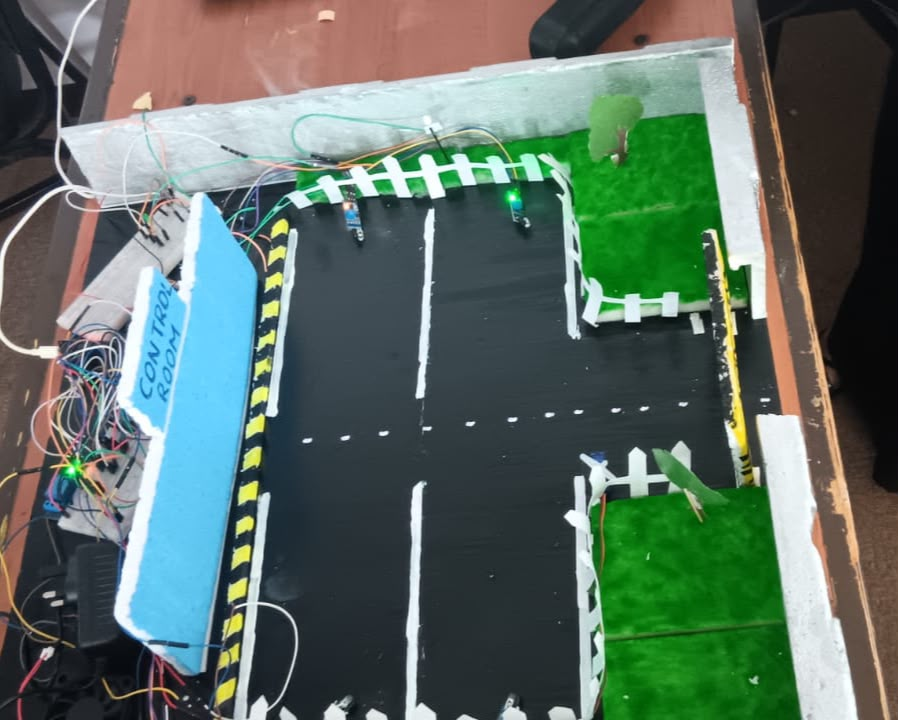

# 🚗 ParkEase Smart Parking System

**Book online. Drive in. Pay. Drive out.**

A complete smart parking demo: AI number-plate gate, customer website, live admin dashboard, IoT sensors and a voice assistant, all synced in real time through Firebase.

  

---

## ✨ Features

- 📷 **Automatic number-plate recognition** at entry and exit (OpenCV + EasyOCR)
- 🌐 **Customer website** to book a slot, check a booking and pay (demo card payment)
- 📊 **Live admin dashboard** with slot map, revenue, gate control and sensor status
- 🔥 **Fire safety**: the flame sensor starts the water pump automatically
- 🅿️ **Real slot sensing** with IR sensors on an ESP32
- 🚧 **Smart gates**: servo barriers that close only after the car has passed
- 🗣️ **ZENVA voice assistant** that answers from live data

## 🔄 How it works

1. The customer books a slot on the website
2. The entry camera reads the plate, the booking becomes **active** and the gate opens
3. At exit the camera reads the plate, the status becomes **awaiting payment** and the gate stays closed
4. The customer pays on the website and the exit gate opens automatically

## 🖼️ Screenshots

| Admin dashboard | ZENVA assistant |
|---|---|
|  |  |

## 🛠️ Hardware prototype

A working scale model: control room, car park entrance and exit gates, IR sensors on each slot, flame sensor, water pump and an ESP32 behind it all.

| Front view | Top view |
|---|---|
|  |  |

## 🗂️ Project structure

| Folder | Purpose |
|---|---|
| `Smart_parking_ai/` | Plate-reading gate script (Python) |
| `User-Website/` | ParkEase customer page |
| `SmartParking_Dashboard/` | Admin dashboard (ready to run) |
| `ZENVA_Assistant/` | Voice assistant (Flask + React) |
| `Arduino_code/` | ESP32 firmware |

## 🚀 Quick start

| Part | How to run |
|---|---|
| Gate | `python -m pip install -r requirements.txt` then `python parking_gate.py` (press **M** to switch entry/exit) |
| Website | Open `User-Website/parkease_User.html` in Chrome or Edge |
| Dashboard | Run `SmartParking_Dashboard/START_DASHBOARD.bat`, then open http://localhost:8001 |
| ZENVA | Run `ZENVA_Assistant/START_ZENVA.bat`, then open http://127.0.0.1:5000 |
| ESP32 | Open the `.ino` in Arduino IDE, set your WiFi details, upload |

## 🧰 Tech stack

Python · OpenCV · EasyOCR · Flask · React · Firebase Realtime Database · ESP32 (Arduino) · HTML / CSS / JavaScript

## ⚠️ Demo notice

This is a demo project. The Firebase rules are open for easy testing, so do not store real customer data.
Lock the rules down before any real use.

---

Built as a smart parking demo. ⭐ Star the repo if you like it!

