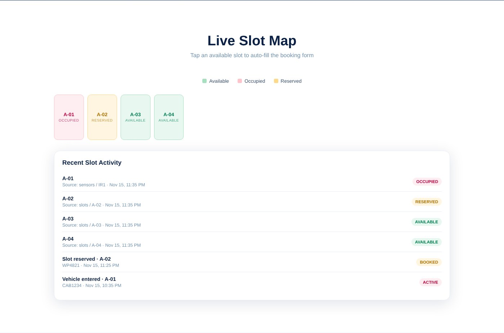
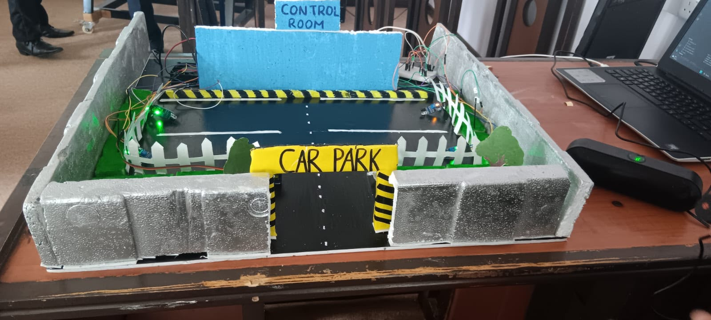

# 🚗 ParkEase Smart Parking System

**Book online. Drive in. Pay. Drive out.**

AI number-plate gate · customer website · live admin dashboard · ESP32 sensors · voice assistant, all synced through Firebase.

---

## ✨ Features

- 📷 **Plate recognition** at entry and exit (OpenCV + EasyOCR)
- 🌐 **Customer website** to book a slot, check a booking and pay (demo payment)
- 📊 **Live admin dashboard** with slot map, revenue, gate control and sensors
- 🅿️ **IR slot sensing** on an ESP32
- 🔥 **Fire safety**: flame sensor starts the water pump automatically
- 🚧 **Smart gates** that close only after the car has passed
- 🗣️ **ZENVA voice assistant** that answers from live data

## 🔄 How it works

1. Customer books a slot on the website
2. Entry camera reads the plate → booking **active**, gate opens
3. Exit camera reads the plate → **awaiting payment**, gate stays closed
4. Customer pays on the website → exit gate opens

## 📸 Screenshots

| Website: booking | Website: live slot map |
|---|---|
|  |  |

| Dashboard | ZENVA assistant |
|---|---|
|  |  |

## 🛠️ Hardware prototype

| Front view | Top view |
|---|---|
|  |  |

## 🗂️ Folders

| Folder | Purpose |
|---|---|
| `Smart_parking_ai/` | Plate-reading gate (Python) |
| `User-Website/` | Customer booking page |
| `SmartParking_Dashboard/` | Admin dashboard |
| `ZENVA_Assistant/` | Voice assistant (Flask + React) |
| `Arduino_code/` | ESP32 firmware |

## 🚀 Quick start

| Part | Run |
|---|---|
| Gate | `python -m pip install -r requirements.txt`, then `python parking_gate.py` (**M** switches entry/exit) |
| Website | Open `User-Website/parkease_User.html` |
| Dashboard | `SmartParking_Dashboard/START_DASHBOARD.bat` → http://localhost:8001 |
| ZENVA | `ZENVA_Assistant/START_ZENVA.bat` → http://127.0.0.1:5000 |
| ESP32 | Open the `.ino` in Arduino IDE, set WiFi, upload |

## 🧰 Tech stack

Python · OpenCV · EasyOCR · Flask · React · Firebase Realtime Database · ESP32 · HTML/CSS/JS

## ⚠️ Demo notice

Demo project. Payment is simulated and the Firebase rules are open, so don't store real customer data. Lock the rules down before real use.
