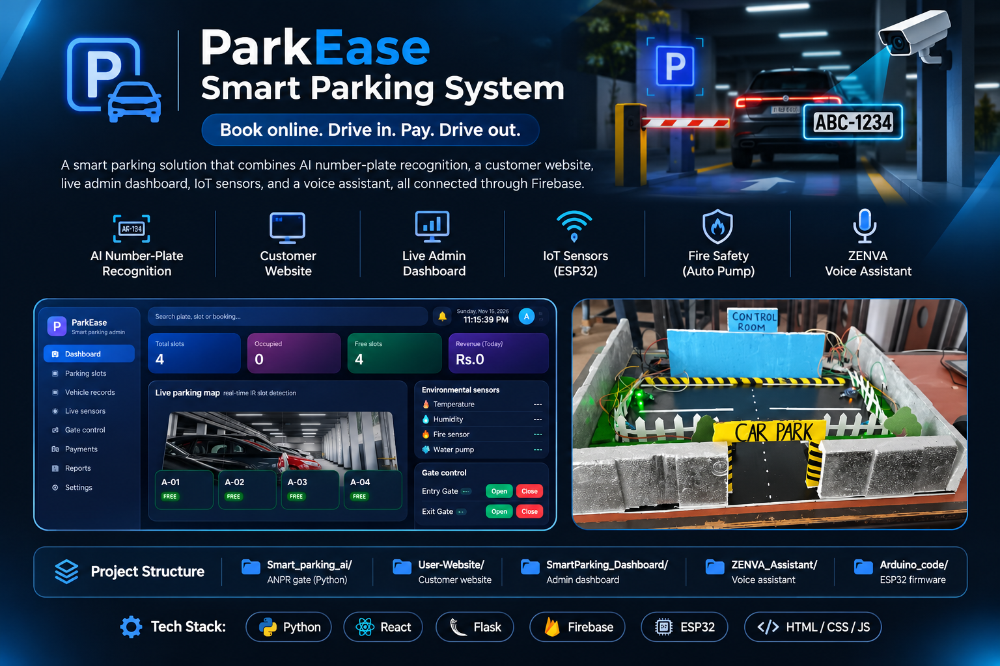
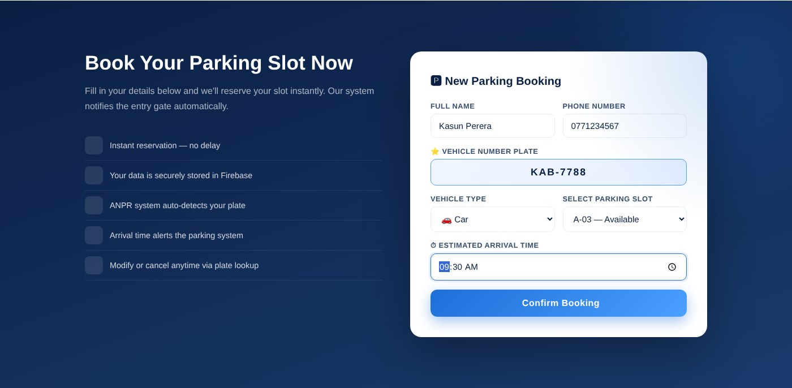
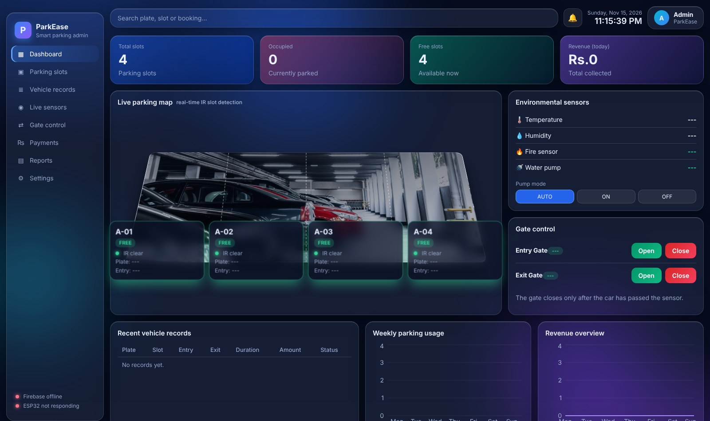

<p align="center">
  
</p>

<p align="center">
  <strong>AI-Powered Smart Parking Management System</strong>
</p>

<p align="center">
  An integrated parking solution combining automatic number plate recognition,
  IoT-based monitoring, online reservations, and real-time management.
</p>

---

## Overview

**ParkEase** is a smart parking management system designed to automate vehicle entry, parking slot allocation, and exit operations.

The system integrates AI-powered number plate recognition, an online booking platform, a real-time administration dashboard, and ESP32-based hardware. Firebase Realtime Database enables communication between the software and hardware components.

## Key Features

- **Automatic Number Plate Recognition** — Detects vehicle registration plates at entry and exit using OpenCV and EasyOCR.
- **Online Parking Reservations** — Allows customers to reserve parking spaces, view bookings, and complete simulated payments.
- **Real-Time Admin Dashboard** — Displays parking availability, vehicle records, revenue, sensor readings, and gate controls.
- **Smart Parking Detection** — Uses ESP32-connected IR sensors to monitor individual parking spaces.
- **Automated Gate Control** — Operates entry and exit barriers based on vehicle detection and booking status.
- **Fire Safety Monitoring** — Automatically activates a water pump when the flame sensor detects fire.
- **ZENVA Voice Assistant** — Provides voice-assisted access to live parking information.

## System Workflow

1. **Reservation:** A customer books an available parking space through the website.
2. **Vehicle Entry:** The entry camera recognizes the number plate, validates the booking, and opens the entrance gate.
3. **Parking Monitoring:** IR sensors update parking space availability in real time.
4. **Vehicle Exit:** The exit camera identifies the vehicle and checks its payment status.
5. **Payment & Departure:** After payment confirmation, the exit gate opens automatically.

## System Screenshots

### Customer Website

| Parking Reservation | Live Parking Availability |
|:---:|:---:|
|  |  |

### Administration & Voice Assistant

| Admin Dashboard | ZENVA Voice Assistant |
|:---:|:---:|
|  |  |

## Hardware Prototype

The physical prototype demonstrates automated entry and exit barriers, individual parking space detection, environmental monitoring, and fire safety automation using an ESP32 microcontroller.

| Front View | Top View |
|:---:|:---:|
|  |  |

## Technology Stack

| Component | Technologies |
|---|---|
| AI & Computer Vision | Python, OpenCV, EasyOCR |
| Customer Website | HTML, CSS, JavaScript |
| Admin Dashboard | Web-based dashboard |
| Voice Assistant | Flask, React |
| Database | Firebase Realtime Database |
| Hardware & IoT | ESP32, IR Sensors, Servo Motors, Flame Sensor |

## Project Structure

```text
ParkEase/
├── Smart_parking_ai/           # ANPR and gate automation
├── User-Website/              # Customer booking website
├── SmartParking_Dashboard/    # Administration dashboard
├── ZENVA_Assistant/           # Voice assistant
├── Arduino_code/              # ESP32 firmware
├── docs/
│   └── images/                # Project screenshots
└── README.md
```

## Getting Started

| Module | Instructions |
|---|---|
| ANPR System | Install dependencies using `python -m pip install -r requirements.txt`, then run `python parking_gate.py` |
| Customer Website | Open `User-Website/parkease_User.html` in a web browser |
| Admin Dashboard | Run `SmartParking_Dashboard/START_DASHBOARD.bat` and visit `http://localhost:8001` |
| ZENVA Assistant | Run `ZENVA_Assistant/START_ZENVA.bat` and visit `http://127.0.0.1:5000` |
| ESP32 Controller | Configure Wi-Fi credentials in the Arduino sketch and upload using Arduino IDE |

**Note:** Press `M` in the ANPR application to switch between entry and exit modes.

## Project Scope

ParkEase is an academic prototype developed to demonstrate the integration of artificial intelligence, IoT hardware, and web-based parking management.

Payment processing is simulated. Firebase security rules must be configured appropriately before deployment, and real customer information should not be stored in the current demonstration environment.

---

<p align="center">
  <strong>ParkEase Smart Parking System</strong><br>
  AI · IoT · Automation · Real-Time Monitoring
</p>
